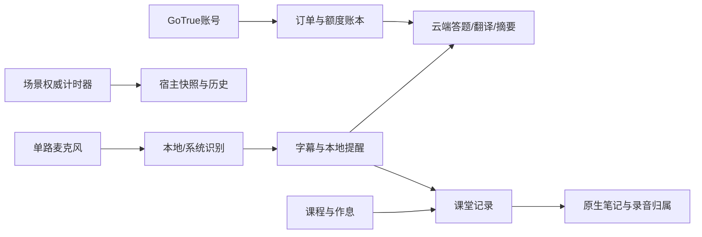

# 学习应用功能源码与接入导航

将 IKO 当前实际实现按功能拆成可复用核心、可运行最小示例与宿主接入参考。仓库名称使用功能名，保留原始类名和接口名方便追溯。

基线：V0.3.11 / build94，2026-11-04；整理：2026-11-06。历史候选方案、已停止使用的套餐与未开放场景不会被写成当前完成状态。每个仓库的 `SOURCE-MANIFEST.json` 记录来源与逐文件 SHA-256，`VALIDATION.md` 记录本次实际结果。

[模块地图与依赖表](MODULE-MAP.md) · [验证总览](VALIDATION.md)

| 功能 | 仓库 | 可以直接运行的内容 |
| --- | --- | --- |
| 课堂实时听写（中英文双语） | [bilingual-live-transcription](https://github.com/TrueYuanYing/bilingual-live-transcription) | Dart 去重、分句、PCM 处理示例与测试 |
| AI 智能答题 | [ai-classroom-assistant](https://github.com/TrueYuanYing/ai-classroom-assistant) | 模拟模型响应；上下文、协议、超时与摘要测试 |
| 课表管理与教务导入 | [course-schedule-import](https://github.com/TrueYuanYing/course-schedule-import) | Node 解析合成页面与采集/解析回归 |
| 原生手写笔记 | [native-handwriting-notes](https://github.com/TrueYuanYing/native-handwriting-notes) | Android 原生 InkView 独立示例与 JVM 测试 |
| 沉浸式专注 | [immersive-focus](https://github.com/TrueYuanYing/immersive-focus) | Web 会话示例、场景协议与 Dart 飞行核心 |
| 账号、支付与额度账本 | [account-quota-service](https://github.com/TrueYuanYing/account-quota-service) | 本机健康检查、合成 HTTP/支付测试与部署模板 |

## 使用顺序

先按各仓库 README 启动最小示例，再读 `docs/ARCHITECTURE.md` 或接入章节。`reference/` 是原产品真实宿主代码，供查调用链，不是可独立启动的完整 App。只有根目录中明确列入构建的源码和示例算本发布的可运行范围。

[普通用户账号、个人 API 与充值教程](https://github.com/TrueYuanYing/account-quota-service/blob/main/docs/USER-GUIDE.md) 与 [开发者部署教程](https://github.com/TrueYuanYing/account-quota-service/blob/main/docs/DEPLOYMENT.md) 分开维护。

## 当前状态与限制

产品历史报告记载 build94 已发布、公测692项通过/9项条件跳过，并有设备验证；这些数字不是本次抽取代码的新测试结果。新发布结果见各仓库 VALIDATION。

公测专注入口只开放 MADO；SHIO 与 KUMO 是源码研究/接入范围，公测入口仍为预告。本机截图 OCR 不上传、不耗模型额度，艺术字课程名仍有识别缺陷。全国逐校真实登录和整学期作息、多机长课堂、极致画质温控、小组件、规则热更新与异机灾备没有被这次整理完成。

自有代码采用 MIT；第三方许可证保持独立。权重、GLB、字体、校徽、Office 运行库、原 APK、签名、备份和原 Git 历史不进入此次发布。详见各仓库 THIRD-PARTY.md。
